# MultimediaServer · Frontend

Cliente web de **MultimediaServer**, una plataforma autoalojada para ver películas y series desde el navegador. Consume la API REST del backend (Spring Boot) y está hecho con **React 19 + Vite 8** en JavaScript.

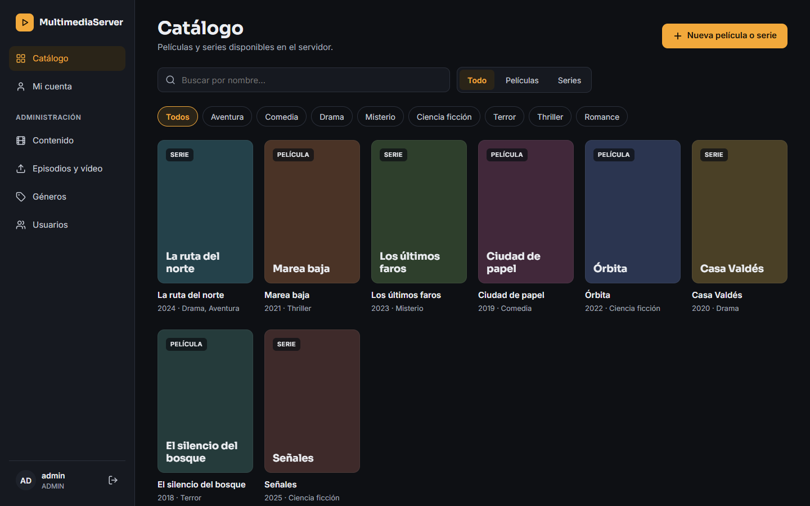

## Funcionalidades

**Para todos los usuarios (USER y ADMIN)**
- Catálogo con búsqueda por nombre, filtro por tipo (películas / series) y por género, y paginación.
- Ficha de cada título: sinopsis, géneros, clasificación y episodios agrupados por temporada.
- Reproductor de vídeo con la lista de siguientes episodios y paso automático al siguiente.
- "Mi cuenta": editar datos personales, nombre de usuario y contraseña. El rol se muestra bloqueado.

**Solo administradores (ADMIN)**
- Gestión de películas y series: alta, edición, póster y borrado en cascada.
- Subida de episodios y vídeos (MP4/WEBM, hasta 10 GB) con barra de progreso.
- Gestión de géneros con edición en línea.
- Gestión de usuarios: alta, edición, cambio de rol y borrado. Las cuentas de otros administradores aparecen bloqueadas.

## Capturas

> Las capturas usan datos de ejemplo.

| | |
|---|---|
| **Inicio de sesión**<br>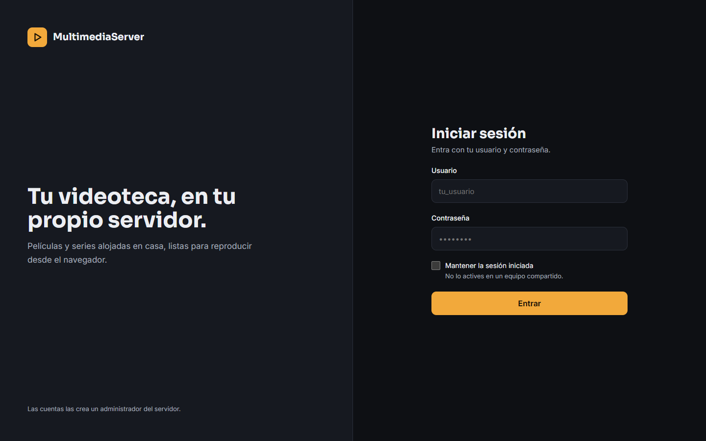 | **Detalle de serie**<br>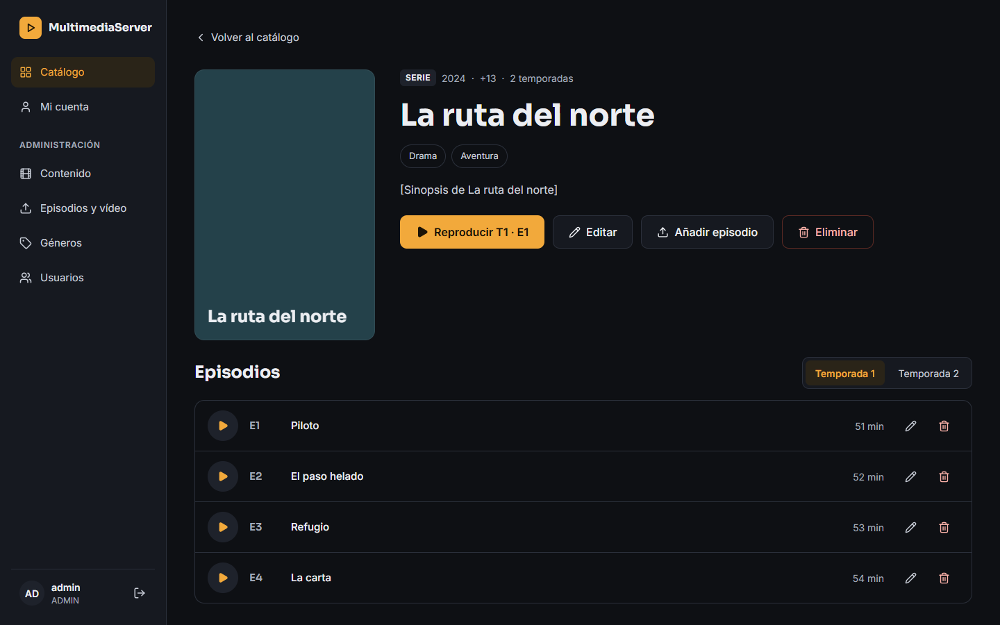 |
| **Reproductor**<br>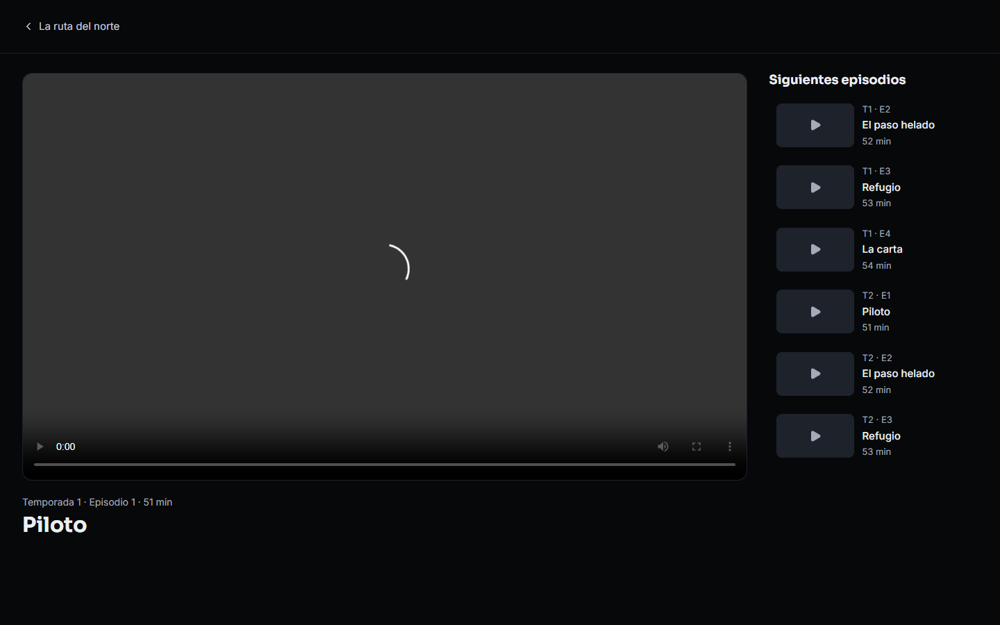 | **Mi cuenta**<br>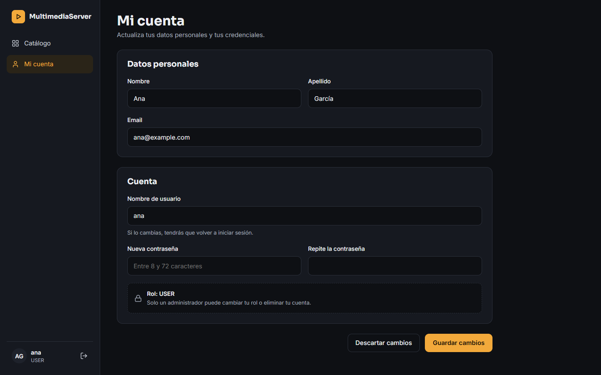 |
| **Administración · Contenido**<br>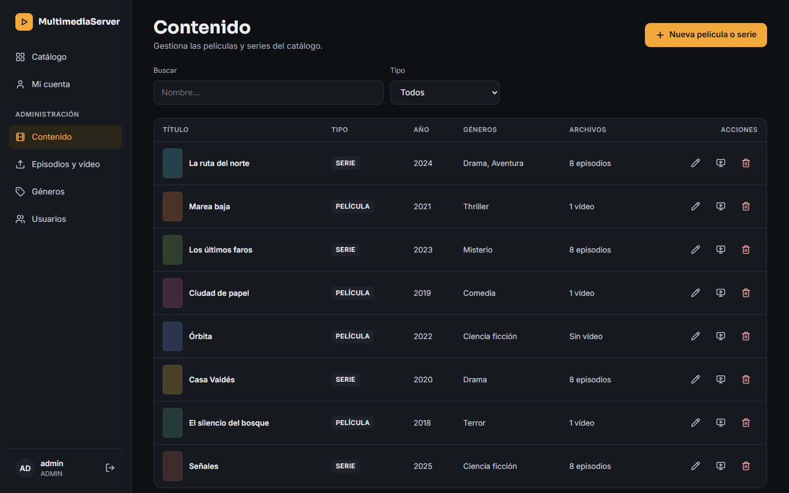 | **Administración · Editar título**<br>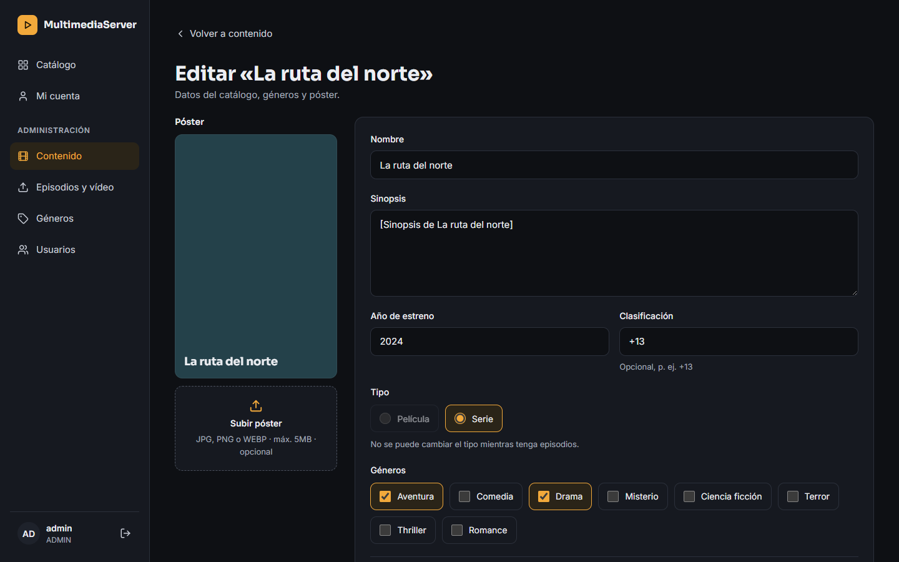 |
| **Administración · Episodios y vídeo**<br>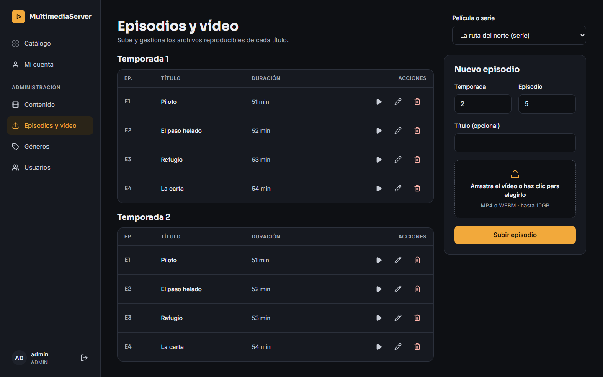 | **Administración · Usuarios**<br>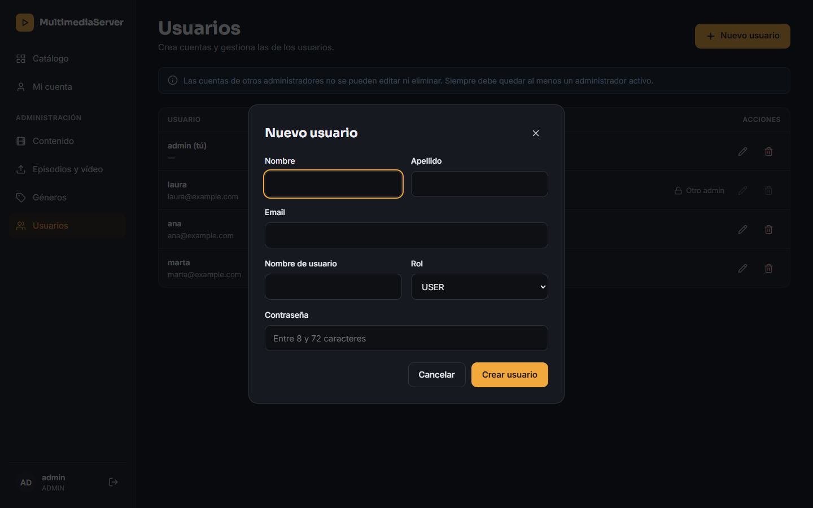 |
| **Administración · Géneros**<br>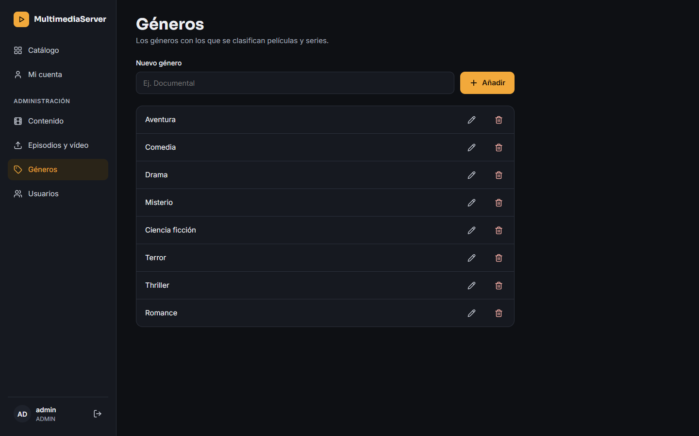 | **Vista móvil**<br>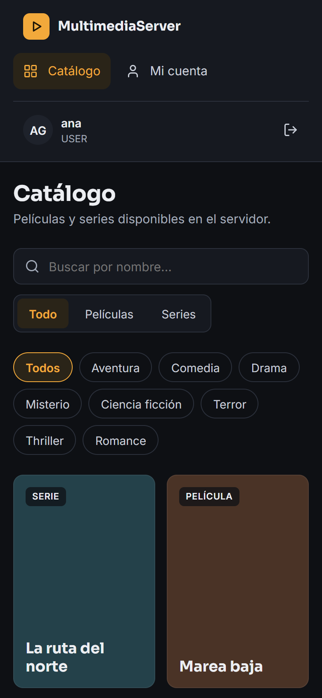 |

## Requisitos

- Node.js 20.19+ o 22.12+ (lo que exige Vite 8; probado con Node 24) y npm.
- El backend de MultimediaServer en marcha (por defecto en `http://localhost:8080`).

## Puesta en marcha

```bash
npm install
cp .env.example .env.local
npm run dev
```

La aplicación queda en http://localhost:5173. Las cuentas las crea un administrador; no hay registro público.

| Script | Qué hace |
|---|---|
| `npm run dev` | Servidor de desarrollo con recarga en caliente |
| `npm run build` | Compila la versión de producción en `dist/` |
| `npm run preview` | Sirve `dist/` en local (con el mismo proxy de la API) |
| `npm run lint` | Revisa el código con oxlint |

## Configuración

Las variables van en `.env.local` (ver `.env.example`):

| Variable | Por defecto | Descripción |
|---|---|---|
| `VITE_API_URL` | `/api` | URL base que usa el navegador para la API. Con `/api`, el servidor de Vite reenvía las peticiones al backend desde el mismo origen, así que no hace falta CORS. |
| `VITE_API_PROXY_TARGET` | `http://localhost:8080` | Dirección del backend a la que el proxy reenvía `/api`. |

En producción, sirve `dist/` y la API desde el **mismo dominio** con un proxy inverso (por ejemplo Nginx: `/` a los archivos estáticos y `/api/` al backend). La otra opción es apuntar `VITE_API_URL` a la URL completa del backend, siempre que este responda con cabeceras CORS.

## Seguridad de la sesión

- La contraseña **nunca se guarda**: solo vive en el formulario de inicio de sesión.
- Solo se guarda el **token JWT**, y únicamente lo gestiona [`src/api/tokenStore.js`](src/api/tokenStore.js):
  - por defecto en `sessionStorage`, así que la sesión termina al cerrar la pestaña o el navegador;
  - en `localStorage` si se marca "Mantener la sesión iniciada" (no recomendado en equipos compartidos).
- Cada petición envía `Authorization: Bearer <token>`. Un token caducado nunca se envía: la sesión se cierra justo cuando vence (`exp` del JWT) y ante cualquier respuesta 401.
- Al cerrar sesión en una pestaña se cierra también en las demás que comparten la sesión.
- La compilación de producción incluye una política de seguridad de contenido (`Content-Security-Policy`).

## Estructura del proyecto

Organizada por funcionalidades. El alias `@/` apunta a `src/`.

```
src/
├── app/            # App, rutas (carga diferida y protección por rol), página 404
├── api/            # Cliente HTTP, almacén del token y un módulo por recurso
├── components/
│   ├── layout/     # Barra lateral y estructura de página
│   └── ui/         # Botones, campos, alertas, modales, paginación…
├── features/
│   ├── auth/       # Contexto de sesión, guards y pantalla de login
│   ├── catalog/    # Catálogo y detalle de títulos
│   ├── player/     # Reproductor
│   ├── account/    # Mi cuenta
│   └── admin/      # Contenido, episodios y vídeo, géneros y usuarios
├── hooks/          # useAsync, usePosterUrl, useGenres…
├── styles/         # Tokens de diseño y estilos compartidos
└── utils/          # Formato de textos y duraciones
```

Los mockups de referencia están en [`docs/mockups/`](docs/mockups/README.md). Las convenciones del proyecto y el contrato de la API están en [`CLAUDE.md`](CLAUDE.md).

## Tecnologías

[React](https://react.dev) · [Vite](https://vite.dev) · [React Router](https://reactrouter.com) · [Lucide](https://lucide.dev) (iconos) · [oxlint](https://oxc.rs) · tipografías Sora e Inter
